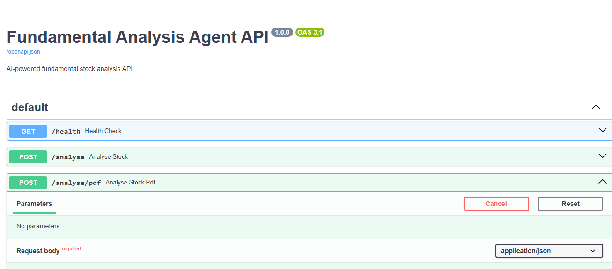
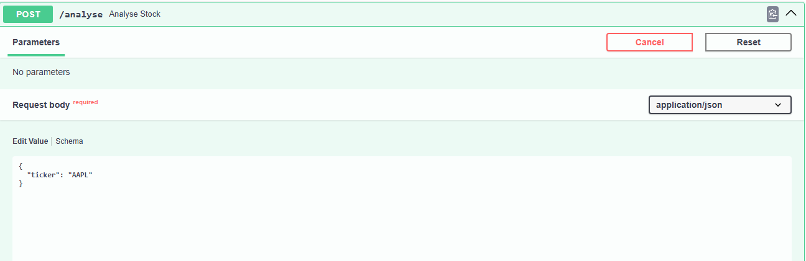
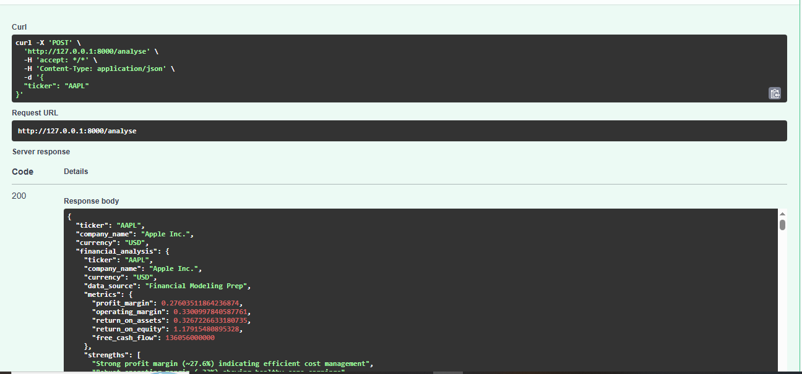
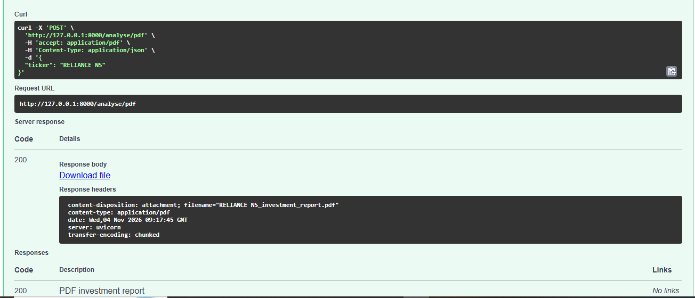
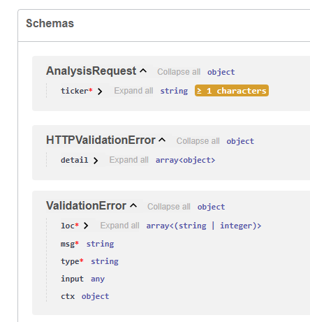
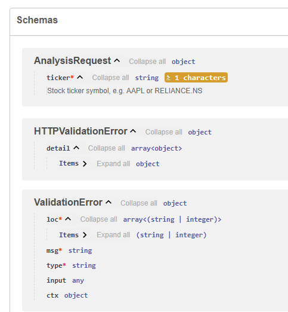
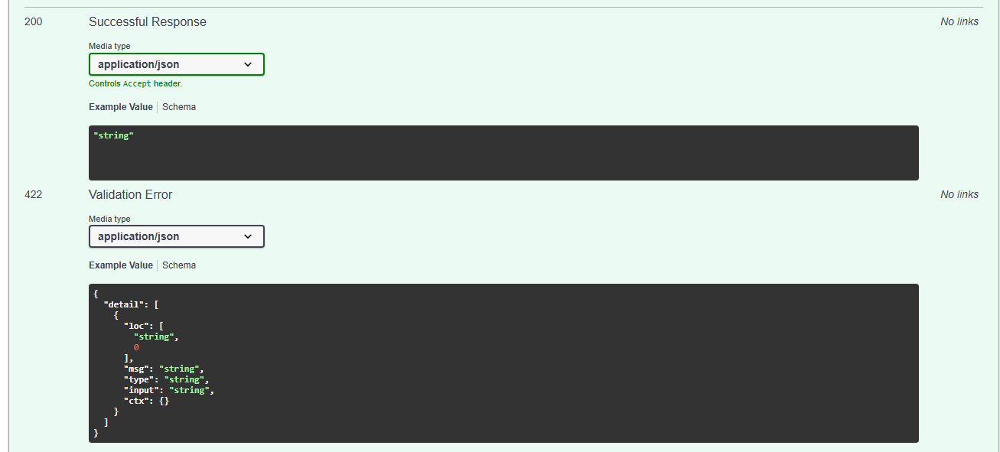
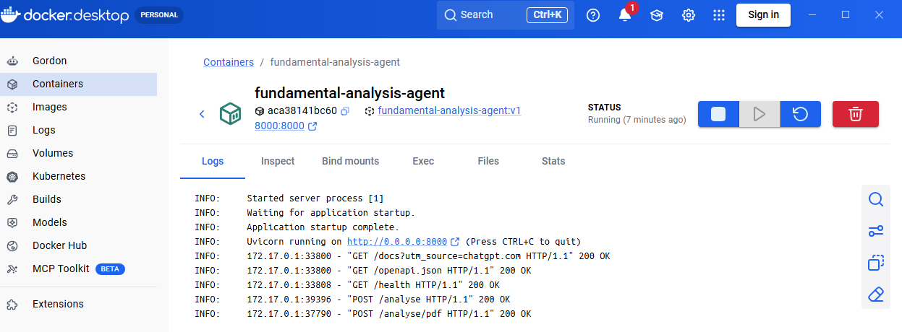

# Fundamental Analysis Agent 📊

A Python-based, multi-agent stock fundamental analysis project for Indian and US equities. The system combines financial data retrieval, deterministic processing, source-aware financial news research, evidence assessment, and LLM-powered interpretation.

The project is developed incrementally with a focus on modular architecture, traceable evidence, provider-aware data handling, and responsible financial analysis.

## 🎯 Project Overview

The goal is to make company financial information and relevant market developments easier to examine through a coordinated set of agents and tools.

The application brings together three specialist capabilities:

1. **Financial data analysis** retrieves and normalizes company financial information from market-specific providers.
2. **Live price analysis** retrieves the latest available market price through the configured data provider.
3. **Financial intelligence analysis** discovers relevant financial news, assesses source provenance and evidence type, and builds a structured report from retrieved articles.

The `InvestmentOrchestrator` coordinates these agents and compiles their outputs into a structured `InvestmentMemo`. The application does not automatically assign a buy, hold, or sell recommendation; the current memo recommendation is `NOT_ASSESSED`.

## ✨ Current Capabilities

### Financial data

- **Multi-provider retrieval:** Uses Financial Modeling Prep (FMP) for supported US stocks and Yahoo Finance through `yfinance` for Indian stocks.
- **Market-aware routing:** Routes symbols to the appropriate data provider.
- **Normalized financial data:** Standardizes provider responses into a common structure.
- **Financial statements:** Retrieves available income statement, balance sheet, and cash flow information.
- **Historical data:** Supports selected financial metrics across reporting periods.
- **LLM-powered interpretation:** Uses Groq for narrative analysis based on retrieved financial information.

### Live price analysis

- Retrieves the latest available price through the stock data provider.
- Includes the price, currency, and data-source context in the analysis output.
- Availability and freshness depend on the underlying provider.

### Financial Intelligence news pipeline

- **Company identity resolution:** Resolves a ticker into company and market context before planning news searches.
- **Query planning:** Builds category-based searches for company developments, financial performance, market reaction, and expert analysis.
- **Curated-first retrieval:** Searches registered publisher domains before using broader fallback searches when category coverage is insufficient.
- **Source registry:** Maintains publisher provenance and source types, including primary sources and registered financial publishers.
- **Evidence assessment:** Classifies articles as primary-source statements, reported facts, analyst opinions, forecasts, or unverified claims.
- **Relevance classification:** Separates relevant articles from rejected results and retains rejection information.
- **Deduplication:** Removes duplicate articles while preserving useful category and provenance metadata.
- **Retrieval diagnostics:** Retains search errors, fallback categories, article counts, and category coverage.
- **VerifiedNewsAgent integration:** Uses the intelligence pipeline by default while retaining an injectable legacy news-search path for compatibility.
- **Structured report building:** Produces a deterministic financial intelligence report containing category groupings, evidence counts, source quality, retrieval summary, and limitations.

### Report evaluation and responsible analysis

- Financial report structures are defined with Pydantic models.
- The report evaluator flags unsupported narrative claims, including unsupported industry comparisons, persistent trends without sufficient periods, leverage claims without debt data, and revenue growth claims inconsistent with supplied historical evidence.
- News claims are **not represented as independently verified** merely because a publisher domain is registered or article metadata is complete.
- News analysis alone does not establish a buy, hold, or sell recommendation.

## 🏗️ Architecture

The `InvestmentOrchestrator` coordinates the specialist agents and compiles their results into an investment memo.

```text
                         Stock Ticker
                              |
                              v
                   InvestmentOrchestrator
                     /        |        \
                    /         |         \
                   v          v          v
          Financial Data   Live Price   Verified News
              Agent          Agent         Agent
                |              |             |
                v              v             v
          Financial data   Latest price   Financial
          and analysis     and currency   Intelligence
                                             |
                                             v
                                      Report Builder
                    \              |             /
                     \             |            /
                      v            v           v
                         Investment Memo
                  - Financial analysis
                  - Price analysis
                  - News analysis
                  - Financial intelligence report
                  - Strengths and concerns
                  - Risks and limitations
                  - Overall summary
                  - Recommendation status
```

The financial intelligence news path is organized as a deterministic pipeline:

```text
Ticker
  |
  v
Company Identity Resolution
  |
  v
Category-based Query Planning
  |
  v
Curated-first News Retrieval
  |                         |
  | insufficient coverage  | search failures
  v                         v
Fallback Searches       Error Tracking
  |
  v
Relevance Classification
  |
  +----> Rejected Articles
  |
  v
Deduplication
  |
  v
Source Provenance + Evidence Assessment
  |
  v
VerifiedNewsAgent
  |
  v
Financial Intelligence Report Builder
  |
  v
Structured Report + Limitations
```

The report builder is deterministic: it organizes the metadata and article results supplied by the news pipeline. It does not invent article summaries, financial metrics, or investment recommendations.

## 🖥️ API and Docker Implementation

The project exposes its investment analysis workflow through a FastAPI application and can be run inside a Docker container.

### FastAPI endpoints

| Method | Endpoint | Description |
|---|---|---|
| GET | `/health` | Checks API availability |
| POST | `/analyse` | Returns a structured investment analysis in JSON |
| POST | `/analyse/pdf` | Generates and returns an investment analysis PDF |

Interactive API documentation is available through Swagger UI at `/docs`.

### FastAPI documentation



### Stock analysis request and JSON response

The `/analyse` endpoint accepts a stock ticker, such as `AAPL` or `RELIANCE.NS`, and returns the structured analysis.





### PDF investment report

The `/analyse/pdf` endpoint generates a downloadable PDF investment report.



### Request and response schemas

The API uses Pydantic models to validate incoming requests and structure its responses.







### Docker implementation

The application is containerized using Docker with Python 3.12 and Uvicorn. The container exposes port `8000` and starts the FastAPI application.



Build the Docker image:

```powershell
docker build -t fundamental-analysis-agent .
```

Run the container:

```powershell
docker run --env-file .env -p 8000:8000 fundamental-analysis-agent
```

Access the API documentation at:

`http://localhost:8000/docs`

API credentials must be supplied through environment variables. The `.env` file should never be committed to GitHub or copied into the Docker image.

## 📁 Sample Outputs

The repository includes sample outputs generated by the Fundamental Analysis Agent, demonstrating analysis across both US and Indian equity markets.

| Sample | Company | Market | Format |
|---|---|---|---|
| [Sample JSON Analysis](examples/sample_analysis.json) | Apple Inc. (`AAPL`) | US | JSON |
| [Sample PDF Investment Report](examples/sample_investment_report.pdf) | Reliance Industries Limited (`RELIANCE.NS`) | India | PDF |

**Sample details:**
- Apple analysis: USD
- Reliance Industries analysis: INR
- Reliance PDF generated: 04 November 2026

These files demonstrate the application's structured analysis and PDF reporting capabilities across different market data providers. They are illustrative outputs, not live market data or investment advice. Financial information may become outdated.

## 🧩 Project Structure

```text
fundamental-analysis-agent/
├── agents/
│   ├── financial_data_agent.py
│   ├── investment_orchestrator.py
│   ├── investment_memo_schema.py
│   ├── live_price_agent.py
│   ├── report_evaluator.py
│   ├── report_schema.py
│   └── verified_news_agent.py
├── api/
│   ├── main.py
│   └── schemas.py
├── config/
│   └── news_sources.yaml
├── docs/
│   └── images/
├── examples/
│   ├── sample_analysis.json
│   └── sample_investment_report.pdf
├── intelligence/
│   ├── article_deduplicator.py
│   ├── evidence_assessor.py
│   ├── identity_resolver.py
│   ├── query_planner.py
│   ├── relevance_classifier.py
│   ├── report_builder.py
│   ├── retrieval_manager.py
│   └── source_registry.py
├── reports/
│   └── pdf_generator.py
├── tests/
├── tools/
│   ├── financial_tools.py
│   ├── fmp_tools.py
│   ├── news_tools.py
│   └── stock_data_router.py
├── .dockerignore
├── .env.example
├── .gitignore
├── Dockerfile
├── requirements.txt
├── run_investment_memo.py
├── test_pdf_generation.py
└── README.md
```

This is a high-level view of the principal project modules; additional supporting files and tests may also be present.

## 🛠️ Technology Stack

- Python 3.12
- FastAPI and Uvicorn
- Docker
- Groq API
- Financial Modeling Prep API
- Yahoo Finance through `yfinance`
- Pandas and NumPy
- Requests
- PyYAML
- python-dotenv
- Pydantic
- ReportLab
- Pytest

## ⚙️ Setup and Installation

### 1. Clone the repository

```bash
git clone https://github.com/MCPraveen1/fundamental-analysis-agent.git
cd fundamental-analysis-agent
```

### 2. Create a virtual environment

```bash
py -3.12 -m venv .venv
```

Activate it in PowerShell:

```powershell
.\.venv\Scripts\Activate.ps1
```

### 3. Install dependencies

```powershell
python -m pip install -r requirements.txt
```

### 4. Configure environment variables

Create a `.env` file in the project root using `.env.example` as a template. Add the credentials required by the providers and features you intend to use:

```text
GROQ_API_KEY=your_groq_api_key
GROQ_MODEL=your_groq_model
FMP_API_KEY=your_fmp_api_key
TAVILY_API_KEY=your_tavily_api_key
```

Not every analysis path requires every provider credential. Configure the credentials needed for the functionality you intend to run.

**Security:** Never commit `.env` or publish API keys to GitHub. Keep credentials in environment variables and use only the provider access required for your tests or analysis.

## ▶️ Running the Application

### Run the FastAPI application locally

From the project root:

```powershell
uvicorn api.main:app --reload
```

Open the interactive API documentation:

`http://127.0.0.1:8000/docs`

### Run the investment memo CLI

```powershell
python run_investment_memo.py
```

### Run the PDF generation test script

```powershell
python test_pdf_generation.py
```

This script performs an analysis and generates a PDF report. It requires the relevant API credentials and provider access.

## 🧪 Testing

Run the test suite from the repository root:

```powershell
python -m pytest -v
```

The test suite covers the financial analysis components, news intelligence pipeline, report evaluation, and supporting functionality. Test totals can change as the project evolves; run the command above for the current result.

## 🧪 Example Stock Symbols

| Market | Example symbol | Data provider |
|---|---|---|
| US | `AAPL` | Financial Modeling Prep |
| India | `RELIANCE.NS` | Yahoo Finance via `yfinance` |

Provider coverage and availability depend on API access, subscription limits, symbol support, and data availability.

## 🔍 Evidence and Source Semantics

The news pipeline distinguishes several concepts that should not be conflated:

- **Registered source:** The article domain matches a publisher in the source registry.
- **Primary source:** The registry identifies the publisher as a primary information source, such as an exchange or regulator.
- **Evidence type:** The article is classified according to the available headline and content signals.
- **Claim verification:** Independent factual verification is a separate activity. A registered domain, primary-source classification, or complete metadata does not by itself establish that every claim is accurate.

The structured report retains search errors, rejected results, incomplete metadata, unknown source classifications, and claims requiring further verification so that limitations remain visible.

## 🗺️ Development Roadmap

- [x] Retrieve financial data from multiple providers
- [x] Normalize financial data into a common structure
- [x] Build an initial Groq-powered financial analysis agent
- [x] Add financial report schema and narrative claim evaluation
- [x] Resolve company identity and plan categorized news searches
- [x] Add a curated source registry and primary-source classification
- [x] Implement curated-first news retrieval and fallback searches
- [x] Add article relevance classification, deduplication, and evidence assessment
- [x] Integrate the intelligence pipeline into VerifiedNewsAgent
- [x] Build structured financial intelligence reports
- [x] Integrate specialist agents through the InvestmentOrchestrator
- [x] Expose analysis through FastAPI JSON and PDF endpoints
- [x] Containerize the application with Docker
- [x] Add sample JSON and PDF outputs
- [ ] Expand official company investor-relations source coverage
- [ ] Add independent claim-verification mechanisms
- [ ] Expand end-to-end integration and provider failure testing
- [ ] Further validate key financial ratios and historical financial interpretations

## ⚠️ Disclaimer

This project is for educational and research purposes only. It does not provide personalized financial advice or recommendations to buy, hold, or sell securities. Financial data and news may be incomplete, delayed, inaccurate, or subject to provider limitations. Always verify information independently before making investment decisions.

## 👨‍💻 Author

**Praveen MC**

- GitHub: [MCPraveen1](https://github.com/MCPraveen1)
- Portfolio: [View my portfolio](https://mcpraveen1.github.io/Portfolio/)
